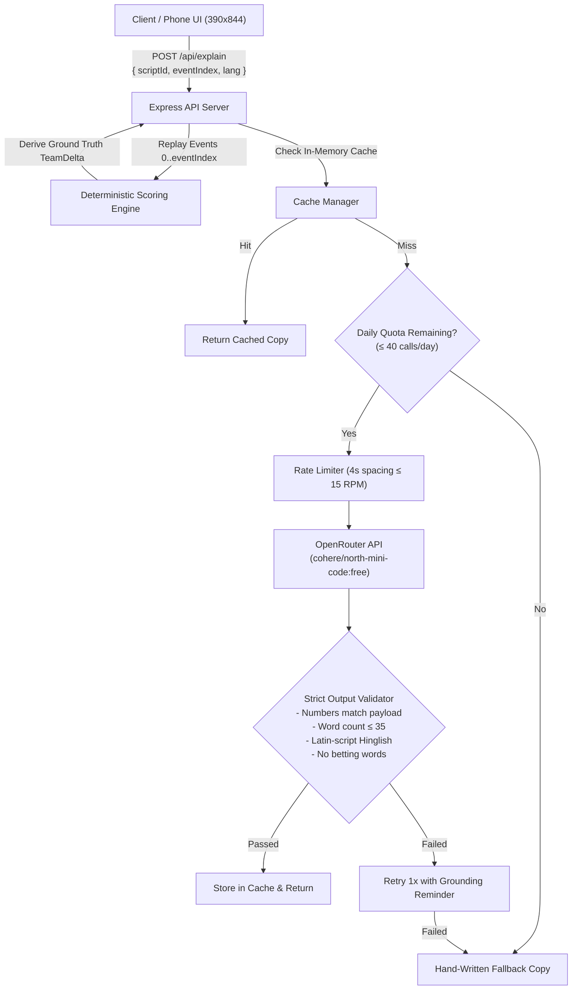

# PointsPulse — "Why Did My Points Just Change?"

A live second-screen fantasy cricket companion that tells a fan, in one plain sentence, why their points just changed, who of their 11 is in play, and who is at risk.

**Live Deployment:** [https://pointspulse.onrender.com](https://pointspulse.onrender.com)  
**Submission Note:** [`SUBMISSION.md`](SUBMISSION.md) (125 words, strictly &le; 200 words)  
**Demo Presentation Script:** [`docs/DEMO.md`](docs/DEMO.md) (5-minute walkthrough)  

> **Disclaimer:** Unofficial prototype built for the Dream11 Forward Deployed Engineer Intern assignment. Not affiliated with Dream11, BCCI, IPL, or any franchise. Match events, player movements, and commentary are simulated.

---

## 1. The Core Architectural Invariant

$$\textbf{Code calculates, AI only phrases.}$$

The deterministic TypeScript engine computes all player points, Captain (2.0x) and Vice-Captain (1.5x) multipliers, provisional economy/strike rate adjustments, state transitions, and risk flags directly from ball-by-ball match events.

The AI layer (connected to OpenRouter's free tier with automated rate-limiting, daily quota guarding, and in-memory caching) translates the server's ground truth delta into natural language. The language model is strictly prohibited from computing, modifying, or inventing numbers.



---

## 2. Key Features

- **Glanceable Mobile First Layout (390×844):** Total points, animated delta badge, and the "Why it changed" explanation card are all visible above the fold without scrolling.
- **Full Match Simulation & Replay Controls:** Play/pause, step ball-by-ball, 1x/5x speed toggle, reset, and scenario switcher.
- **3 Realistic Match Scenarios:**
  1. *Full Match:* Comprehensive simulation covering all 14 official Dream11 T20 scoring moments.
  2. *Powerplay Blitz:* Fast boundaries, milestone bonuses (30/50 runs), and VC impact.
  3. *Late Collapse:* Middle-order wickets, duck penalties, and active collapse warnings.
- **Itemized Breakdown Drawer:** Tap "See breakdown ▾" to inspect the exact math behind any player's score (dismissal points, boundary bonuses, economy thresholds, multipliers).
- **Dual Language Support (English & Hinglish):** Instant language toggle. Hinglish is strictly Romanized Latin script (*"Kyun badha / ghata"*, *"Bumrah ne clean bowled kiya"*).
- **9 Automated Rule-Based Risk Flags:** Real-time risk detection for duck threats, expensive bowler penalties, batting collapses, rain-reduced overs, and batters unlikely to bat.
- **Catch-Up Timeline & Grounded Q&A:** Reverse-chronological ball history with a "⚡ Catch Me Up" 2-line match recap button and interactive team Q&A grounded strictly in match snapshots.

---

## 3. Verified Scoring & 5 Golden Anchors

Points are scored according to official Dream11 T20 rules cited from official documentation ([`docs/SCORING.md`](docs/SCORING.md)):

| Golden Anchor | Player & Role | Multiplier | Verification Target | Status |
|---|---|:---:|---|:---:|
| **Batter Anchor** | Rohit Sharma (BAT) | 1.0x | 9.0 pts (4 playing XI + 4 runs + 1 boundary) | **VERIFIED** |
| **Bowler Anchor** | Matheesha Pathirana (BOWL) | 1.0x | 101.0 pts (4 XI + 75 wkts + 16 bowled/lbw + 4 haul + 2 econ) | **VERIFIED** |
| **Fielder Anchor** | Ravindra Jadeja (AR) | 1.0x | 44.0 pts (4 XI + 24 catches + 4 3-catch bonus + 12 runout) | **VERIFIED** |
| **Captain Anchor** | Jasprit Bumrah (BOWL) | **2.0x** | 162.0 pts (81.0 base &times; 2.0) | **VERIFIED** |
| **Vice-Captain Anchor** | Suryakumar Yadav (BAT) | **1.5x** | 132.0 pts (88.0 base &times; 1.5) | **VERIFIED** |

---

## 4. Documentation Index

- [`SUBMISSION.md`](SUBMISSION.md): Candidate submission note (&le; 200 words).
- [`docs/DEMO.md`](docs/DEMO.md): 5-minute live presentation script and walkthrough steps.
- [`docs/SCORING.md`](docs/SCORING.md): Official Dream11 T20 rules reference, benchmark anchors, and 14-scenario coverage matrix.
- [`docs/AI.md`](docs/AI.md): AI architecture, OpenRouter free-tier setup, caching, rate-limiting, and 20-case safety eval report.
- [`docs/HINGLISH.md`](docs/HINGLISH.md): Hinglish grammar standards, cricket vocabulary, and Latin-script verification rules.

---

## 5. Development & Testing

### Prerequisites
- Node.js 20+ (developed on Node 26)
- npm 10+

### Installation & Run
```bash
# Clone and install dependencies
git clone https://github.com/devjuneja789/pointspulse.git
cd pointspulse
npm install

# Copy environment template
cp .env.example .env

# Run development servers concurrently (port 3001 backend, port 5173 frontend)
npm run dev
```

### Comprehensive Test Commands
```bash
# Run Vitest unit & eval suite (60 tests across engine, data, AI safety, and QA hardening)
npm test

# Run Playwright E2E tests (12 tests across Mobile Chrome 390x844 and Desktop Chrome)
npm run test:e2e

# Run TypeScript type check
npm run typecheck

# Run ESLint check
npm run lint

# Validate data schemas, squads, continuity, and coverage matrix
npm run validate:data

# Production build (Vite client + tsup server)
npm run build

# Start production server
npm start
```

---

## 6. Render Deployment

The repository includes a ready-to-deploy [`render.yaml`](render.yaml) blueprint:
1. Connect this GitHub repository to Render.
2. Select **New > Blueprint** and choose the repo.
3. Configure environment variables in the Render Dashboard:
   - `NODE_ENV`: `production`
   - `LLM_MODE`: `live` (or `mock` for deterministic test mode)
   - `LLM_API_KEY`: `<Your-OpenRouter-Key>`
   - `LLM_MODEL`: `cohere/north-mini-code:free`
   - `LLM_DAILY_LIMIT`: `40`
4. Render builds via `npm ci && npm run build` and starts via `npm start`.
