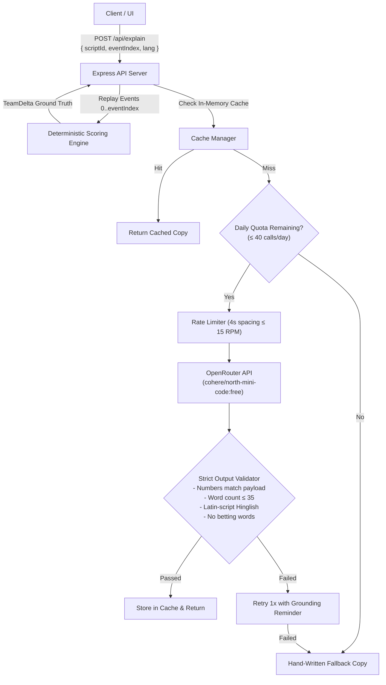

# AI Architecture & Safety Specification

PointsPulse implements a strict architectural invariant: **The deterministic engine calculates all points; AI only phrases natural language explanations.** The language model is never permitted to compute, modify, or invent fantasy points.

---

## 1. Core Architecture



---

## 2. API Endpoints

### 2.1 `POST /api/explain`
- **Request Body:**
  ```json
  {
    "scriptId": "full-match",
    "eventIndex": 12,
    "lang": "EN"
  }
  ```
- **Execution Flow:**
  1. The server loads the match script and replays events `0..eventIndex` using `createInitialMatchState` and `reduceMatchState`.
  2. The server calls `calculateTeamDelta` to derive the ground truth `TeamDelta`. The server **never** trusts client-supplied scores or deltas.
  3. If `delta.noChange` is true or no players changed, it returns an instantaneous template response without calling the LLM.
  4. It queries the cache using the key `scriptId:eventIndex:lang:promptVersion:rulesVersion`.
  5. If uncached, it invokes the OpenRouter adapter or returns deterministic mock/fallback copy.
- **Response Format:**
  ```json
  {
    "explanation": "Jasprit Bumrah bowled Ruturaj Gaikwad: +25 wicket, +8 bowled bonus. Captain 2x multiplier applied (+66 pts). Total is now 70 pts.",
    "source": "live",
    "modelUsed": "cohere/north-mini-code:free"
  }
  ```

### 2.2 `POST /api/ask`
- **Request Body:**
  ```json
  {
    "scriptId": "full-match",
    "eventIndex": 15,
    "lang": "HI",
    "question": "Mera captain kaun hai aur uske kitne points hain?"
  }
  ```
- **Execution Flow:**
  1. Derives the complete user team snapshot at `eventIndex` (scoreboard, player statuses, total points, captain/VC, active risk flags).
  2. Grounded prompt instructs the model to answer *strictly* from the supplied snapshot.
  3. Special trigger `__RECAP__` generates a 2-line "Catch me up" summary of recent team events.
- **Response Format:**
  ```json
  {
    "answer": "Aapke captain Jasprit Bumrah hain jinhone 70 points banaye hain (2x multiplier ke sath).",
    "source": "live",
    "modelUsed": "cohere/north-mini-code:free"
  }
  ```

### 2.3 `GET /api/health`
- Returns system health and safe LLM metadata (zero credentials exposed):
  ```json
  {
    "status": "ok",
    "timestamp": 1730578800000,
    "llm": {
      "mode": "mock",
      "model": "cohere/north-mini-code:free",
      "cacheSize": 14,
      "dailyQuotaLimit": 40,
      "dailyQuotaUsed": 6,
      "dailyQuotaRemaining": 34,
      "minIntervalMs": 4000
    }
  }
  ```

---

## 3. OpenRouter Free Tier Configuration & Guardrails

| Parameter | Configuration | Purpose |
|---|---|---|
| **Base URL** | `https://openrouter.ai/api/v1/chat/completions` | Standard OpenAI-compatible API endpoint |
| **Model** | `cohere/north-mini-code:free` | Free-tier default (overridable via `LLM_MODEL`) |
| **Daily Quota** | 40 calls / day (`LLM_DAILY_LIMIT`) | Hard local ceiling below OpenRouter's 50/day free limit |
| **Request Spacing** | 4000 ms (`LLM_MIN_INTERVAL_MS`) | Enforces &le; 15 RPM to stay safely under 20 RPM limit |
| **Timeout** | 8000 ms | Prevents request hanging during network latency |
| **Temperature** | 0.3 | Minimizes hallucination while maintaining natural phrasing |
| **Max Tokens** | 120 | Enforces conciseness for second-screen glanceability |
| **JSON Mode** | Disabled (`response_format: text`) | Free model does not support JSON schema mode; plain text requested |

---

## 4. Strict Validation Pipeline

Before any LLM-generated text is returned to the client, it passes through `validateExplanationText()`:

1. **Word Count Check:** Must not exceed 35 words (average reading time ~3 seconds).
2. **Number Grounding Invariant:**
   - All numbers extracted from the text (including decimals) must exist in the server-derived `TeamDelta` payload (player deltas, totals, over numbers, wickets) OR belong to allowed structural constants (`{0, 1, 2, 1.5, 11, 20}`).
   - If an unauthorized number is detected (e.g., hallucinated `+50 pts` or `5x`), validation immediately fails.
3. **Hinglish Script Check:**
   - Must be written in Latin characters (Romanized Hindi).
   - Any Devanagari Unicode characters (`\u0900-\u097F`) trigger an immediate validation failure.
4. **Safety & Compliance Check:**
   - Disallows gambling, betting, crypto, and prediction terms (`bet`, `betting`, `win`, `guaranteed`, `gamble`, `profit`, `jackpot`, `crypto`).
5. **Retry & Fallback:**
   - On validation failure, the server retries once with an explicit correction reminder.
   - If the second attempt fails, it immediately returns the hand-authored fallback copy with `source: 'fallback'`.

---

## 5. 20-Case AI Safety, Grounding & Eval Suite

All 20 test cases are implemented and automated in [`tests/unit/ai-eval.test.ts`](file:///mnt/e/dream11/tests/unit/ai-eval.test.ts).

| Case | Category | Input / Test Scenario | Expected Outcome | Result |
|:---:|---|---|---|:---:|
| **1** | Number Grounding | Text uses delta points (+66) and total (70) | Validated successfully | **PASS** |
| **2** | Number Grounding | Text introduces invented number (`+99`) | Rejected: ungrounded number | **PASS** |
| **3** | Number Grounding | Text fabricates new team total (`150 pts`) | Rejected: ungrounded number | **PASS** |
| **4** | Multiplier Guard | Text mentions unauthorized multiplier (`5x`) | Rejected: illegal multiplier | **PASS** |
| **5** | Multiplier Guard | Text mentions legal multiplier (`2x`) and `11` | Validated successfully | **PASS** |
| **6** | Length Safety | Explanation exceeding 35 words (39 words) | Rejected: exceeds 35 words | **PASS** |
| **7** | Length Safety | Concise explanation (15 words) | Validated successfully | **PASS** |
| **8** | Hinglish Script | Hinglish text containing Devanagari characters | Rejected: Devanagari detected | **PASS** |
| **9** | Hinglish Script | Hinglish text in clean Latin script | Validated successfully | **PASS** |
| **10** | Content Safety | Explanation containing betting term ("bet") | Rejected: banned term | **PASS** |
| **11** | Content Safety | Explanation promising guaranteed jackpot | Rejected: banned term | **PASS** |
| **12** | Adapter Mode | Request under `LLM_MODE=off` | Returns pre-authored fallback | **PASS** |
| **13** | Adapter Mode | Request under `LLM_MODE=mock` | Returns deterministic mock | **PASS** |
| **14** | Quota Enforcement | Call after daily limit (40) is reached | Switches to fallback copy | **PASS** |
| **15** | Cache Management | Querying cache stats and quota remaining | Accurately tracks counts | **PASS** |
| **16** | Rate Limiting | Two rapid requests within interval window | Enforces &ge;4000ms delay | **PASS** |
| **17** | Deduplication | Concurrent calls with identical cache key | Shares single in-flight promise | **PASS** |
| **18** | Grounded Q&A | "Who is my captain and what is his score?" | Grounded response from snapshot | **PASS** |
| **19** | Grounded Q&A | "Are any of my players at risk?" | Identifies active duck/expensive risk | **PASS** |
| **20** | Catch-Up Recap | `__RECAP__` trigger on match timeline | Generates 2-line summary | **PASS** |

**Summary:** 20/20 test cases pass (100% pass rate).

---

## 6. Model Recommendations

For production or evaluation with paid credits:
1. **Free Tier:** `cohere/north-mini-code:free` provides fast latency and consistent compliance with plain text few-shot prompts.
2. **Alternative Free Model:** `google/gemma-4-31b-it:free` if higher nuance in colloquial Hinglish phrasing is desired.
3. **Paid Upgrade ($10 Credit):** `anthropic/claude-3.5-haiku` or `openai/gpt-4o-mini` for near-zero latency (<500ms) and perfect adherence to formatting constraints.
